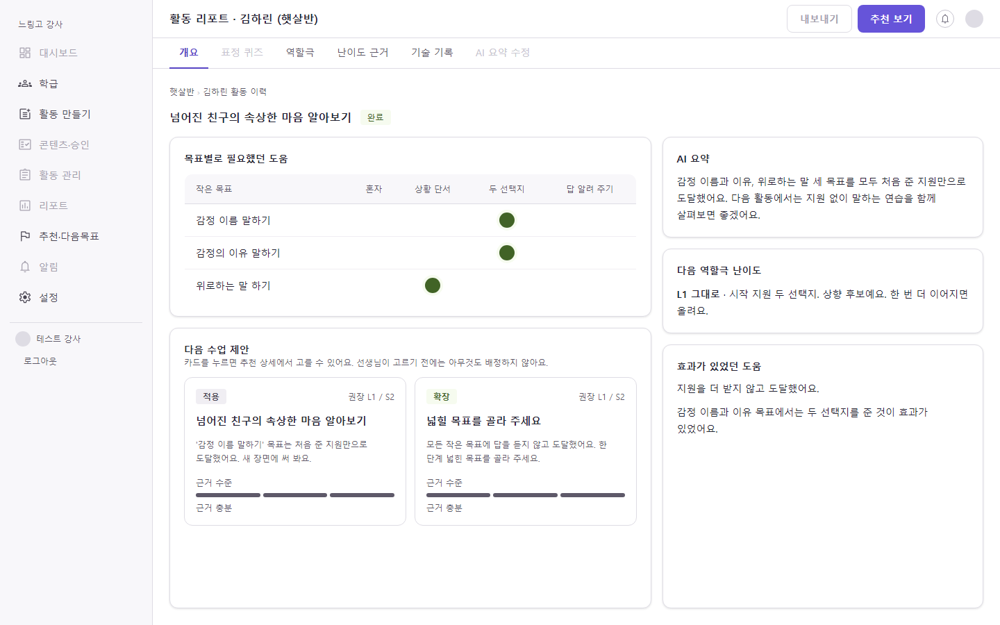
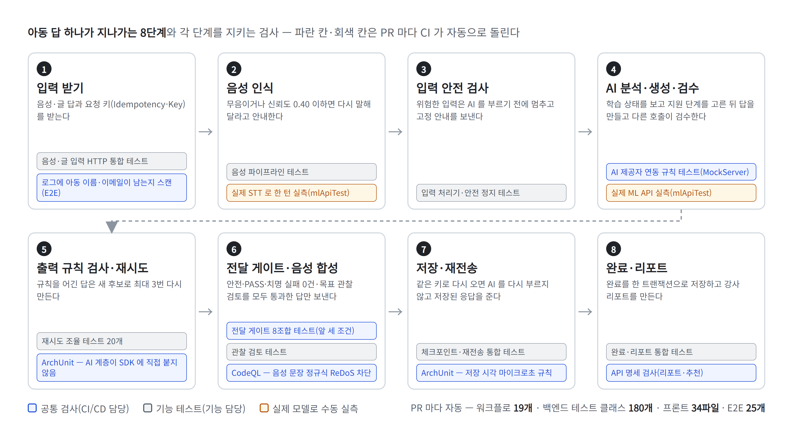
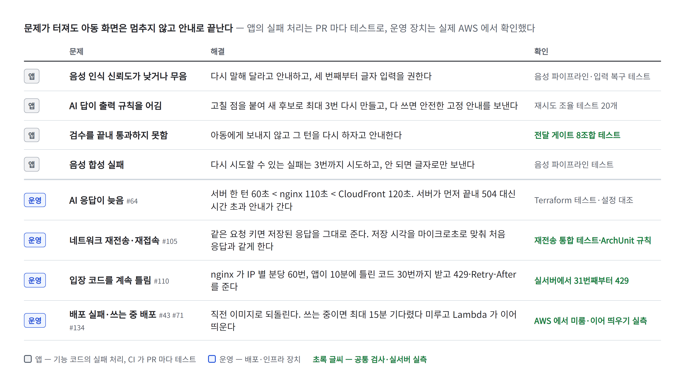
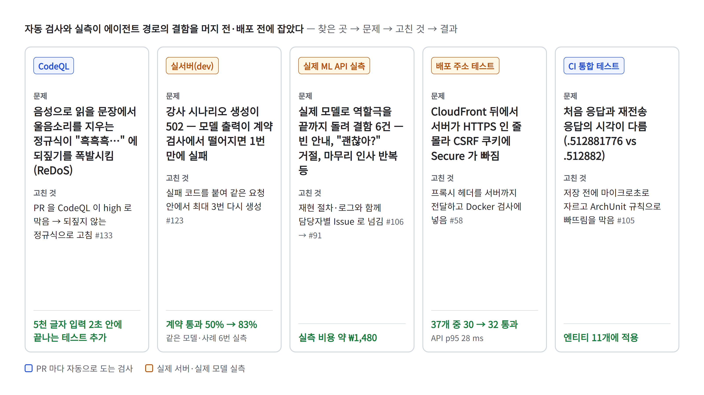
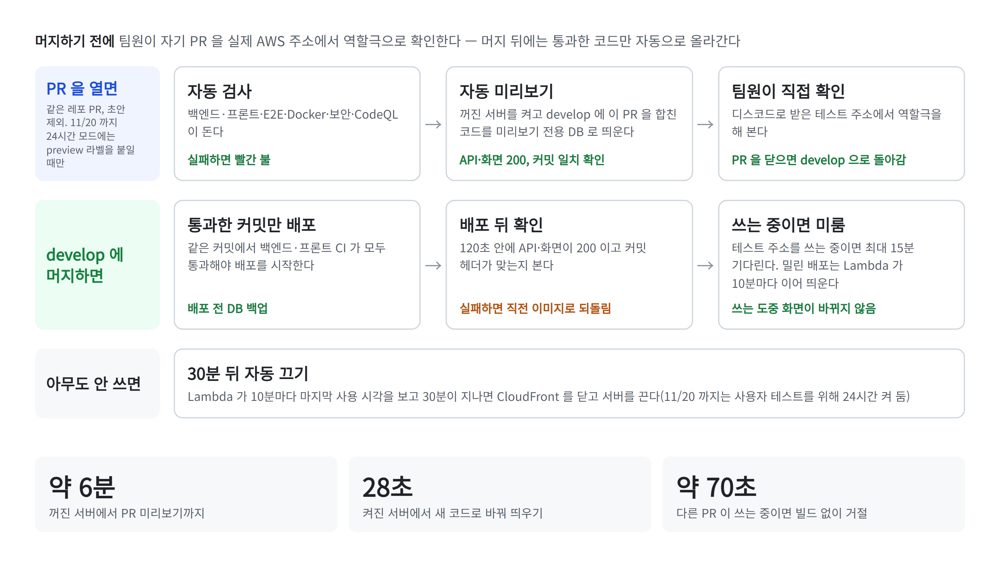
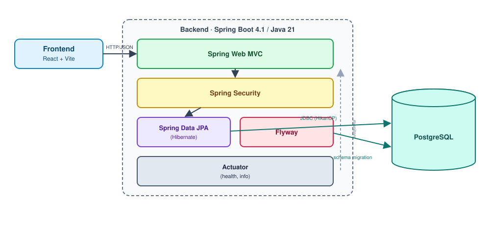

<div align="center">

# 느링고 (Neuringo)

**느린학습자 아동은 AI 캐릭터와 역할극으로 마음을 말하는 연습을 하고,<br>강사는 아동이 어떤 도움으로 목표에 닿았는지 근거를 리포트로 받는다**

카카오테크 캠퍼스 4기 2단계 · 전남대 4팀

<!-- 배포 주소와 시연 영상 링크는 팀이 공개 여부를 정한 뒤 여기에 넣는다 -->

</div>

---

## 목차

1. [소개](#소개)
2. [서비스 흐름](#서비스-흐름)
3. [AI 에이전트 한 턴](#ai-에이전트-한-턴)
4. [리포트, 다음 난이도, 추천](#리포트-다음-난이도-추천)
5. [실패해도 안내로 끝나는 설계](#실패해도-안내로-끝나는-설계)
6. [품질과 테스트](#품질과-테스트)
7. [배포와 운영](#배포와-운영)
8. [기술 스택과 구조](#기술-스택과-구조)
9. [로컬에서 실행하기](#로컬에서-실행하기)
10. [문서](#문서)
11. [팀](#팀)

---

## 소개

느링고는 느린학습자 아동을 가르치는 강사를 위한 서비스다. 감정을 알아차리고 말로 표현하는 연습은 아이 수준에 맞는 도움을 받으며 여러 번 되풀이해야 한다. 그런데 강사 한 명이 아동마다 대화 상대가 되어 주고, 아이가 어느 단계에서 막혔는지까지 기록하기는 어렵다. 그래서 느링고는 대화 상대 역할을 AI 캐릭터에게 맡기고, 강사에게는 다음 수업을 정할 근거를 돌려준다.

AI 는 아동의 답을 보고 다음에 줄 도움을 스스로 고른다. 열린 질문으로 혼자 답하게 할지, 상황 단서를 줄지, 두 선택지를 보여 줄지, 답을 알려 줄지를 한 턴마다 정하고, 위험한 답이 나오면 대화를 멈춘다. 학습이 끝나면 강사는 목표마다 아동이 어떤 도움을 받고 도달했는지, 다음 역할극 난이도와 다음 수업 추천을 리포트로 받는다. 추천은 후보일 뿐이고, 강사가 고르기 전에는 아무것도 자동으로 배정하지 않는다.

## 서비스 흐름

강사가 활동을 만들어 배정하면 아동이 표정 퀴즈와 역할극을 하고, 결과가 다시 강사에게 돌아온다.

| 단계 | 누가 | 하는 일 |
| --- | --- | --- |
| 1. 활동 만들기 | 강사 | 아동, 학습 목표, 역할극 조건을 정하면 AI 가 시나리오 후보를 만든다. 강사가 검토하고 고쳐서 승인한 시나리오만 배정되고, 승인한 시나리오는 다른 아동에게 다시 쓸 수 있다. |
| 2. 입장 | 아동 | 강사가 발급한 숫자 4자리 입장 코드로 들어온다. 아동 계정은 따로 없고, 코드는 HMAC 해시로만 저장한다. |
| 3. 표정 퀴즈 | 아동 | 감정 문항에 답하고 힌트를 두 번까지 받는다. 정답은 서버가 판정한다. 내 감정 문항은 카메라 앞에서 표정을 지어 답하는데, 브라우저 안에서 표정을 판정하고 가장 높은 표정의 확률이 50% 미만이면 다시 찍게 한다. |
| 4. 역할극 | 아동 | 캐릭터와 음성이나 글로 대화하고, 캐릭터의 대사는 음성으로 다시 들을 수 있다. 점수를 매기지 않고 칭찬으로 마무리하며, 끝나면 스탬프를 하나 받는다. |
| 5. 리포트와 추천 | 강사 | 목표별로 필요했던 도움, AI 요약, 다음 역할극 난이도, 다음 수업 추천을 보고 다음 목표를 고른다. |

<!-- 아동 화면(입장, 표정 퀴즈, 역할극, 스탬프) 캡처나 GIF 를 여기에 넣는다 -->

아래는 강사가 받는 활동 리포트다. 왼쪽 표는 작은 목표마다 아동이 어느 도움 단계에서 도달했는지 보여 주고, 오른쪽에는 AI 요약과 다음 역할극 난이도가, 아래에는 다음 수업 제안 카드가 있다. 로컬에서 가상 아동 데이터로 찍은 화면이다.

<p align="center"></p>

## AI 에이전트 한 턴

역할극에서 아동의 답 하나가 들어오면 서버는 AI 호출 세 번으로 한 턴을 처리한다. 먼저 원인 분석이 아동의 답과 지금까지의 학습 상태를 보고 목표에 도달했는지, 다음에 어떤 도움을 줄지 고른다. 이어서 응답 생성이 그 판단대로 캐릭터의 대사를 만들고, 마지막으로 응답 평가가 그 대사가 안전하고 판단과 맞는지 검수한다. 음성으로 답한 경우에는 앞뒤로 음성 인식(STT)과 음성 합성(TTS)이 붙는다.

도움 단계는 네 가지다. AI 는 한 번에 한 단계씩만 도움을 늘리고, 도움을 줄여서 다시 유도하지 않는다. 아동이 서로 다른 목표 두 개를 연달아 혼자 해내면 다음 목표는 한 단계 낮은 도움에서 시작한다. 답을 알려 준 뒤(S3) 도달한 목표는 혼자 해낸 목표와 구분해 리포트에 남긴다.

| 단계 | 아동에게 주는 도움 |
| --- | --- |
| S0 | 열린 질문으로 혼자 답하게 한다 |
| S1 | 상황 단서를 준다 |
| S2 | 두 선택지 중에서 고르게 한다 |
| S3 | 답을 알려 준다 |

AI 가 만든 답이 바로 아이에게 가지는 않는다. 평가가 안전하다고 판단하고(`safe_to_send`), 통과(`PASS`)를 주고, 치명적 실패가 0건이고, 목표 관찰 검토까지 통과해야 전달한다. 출력 규칙을 어긴 답은 고칠 점을 붙여 새 후보로 최대 세 번 다시 만들고, 그래도 안 되면 미리 정한 안전한 안내를 보낸다. 평가가 위험(`SAFETY_ESCALATION`)으로 판단하면 대화를 멈추고 아동과 강사에게 각각 정해진 안내를 보낸다.

아래 그림은 한 턴이 지나가는 8단계와, 각 단계를 PR 마다 검사하는 테스트를 함께 보여 준다. 파란 칸은 여러 기능에 걸친 공통 검사이고, 회색 칸은 기능 테스트, 주황 칸은 실제 모델로 따로 돌리는 실측이다.

<p align="center"></p>

## 리포트, 다음 난이도, 추천

역할극이 끝나 완료가 저장되면 리포트를 두 단계로 만든다. 첫 단계는 AI 없이 규칙으로 목표별 결과와 점수율, 다음 난이도, 추천 후보를 정한다. 점수율이 50% 아래면 난이도를 내리고 80% 이상이면 상향 후보로 두는데, 상향 후보가 두 번 이어져야 실제로 올린다. 한 번 잘한 것만으로 바로 어렵게 만들지 않기 위해서다. 추천은 보완, 반복, 적용, 확장 네 가지이고, 기술 오류나 중단으로 판단하지 못한 목표는 근거에서 뺀다. 그래서 기술 오류만으로 보완 추천이 생기지 않는다.

둘째 단계에서 AI 가 강사용 요약을 쓴다. 다른 호출이 초안을 검토해 고칠 점을 돌려주면 그 지시를 붙여 다시 쓰고, 이 과정을 최대 세 바퀴 돈다. 진단을 단정하는 표현이나 근거에 없는 문장은 규칙으로 따로 막는다. 요약 생성이 실패해도 첫 단계에서 정한 지표, 난이도, 추천은 그대로 남는다.

## 실패해도 안내로 끝나는 설계

AI 응답이 늦거나, 규칙을 어기거나, 네트워크가 끊겨도 아동 화면은 멈추지 않고 안내로 끝나야 한다. 아래 표의 위쪽 네 줄은 앱 코드의 실패 처리로, PR 마다 테스트로 확인한다. 아래쪽 네 줄은 배포와 인프라 쪽 장치로, 실제 AWS 환경에서 확인했다.

제한 시간은 안쪽일수록 짧게 맞췄다. 서버의 한 턴 제한(60초)이 nginx(110초)와 CloudFront(120초)보다 먼저 끝나야, 아동은 게이트웨이 오류(504) 대신 서버가 만든 시간 초과 안내를 받는다. 같은 요청이 다시 오면 AI 를 다시 부르지 않고 저장된 응답을 그대로 돌려주며, 처음 응답과 시각까지 같도록 저장 시각을 마이크로초 단위로 맞춘다.

<p align="center"></p>

## 품질과 테스트

PR 을 열면 GitHub Actions 가 백엔드와 프론트 빌드, 단위 테스트와 통합 테스트, 브라우저 종단 테스트(E2E), 정적 분석(CodeQL), 비밀값 검사(gitleaks)를 돌린다. 백엔드 통합 테스트는 Testcontainers 로 실제 PostgreSQL 을 띄우고, AI 제공자는 MockServer 로 흉내 내서 실제 키 없이 실패 유형과 재시도 분기를 확인한다. E2E 는 PC 와 태블릿 화면에서 돌리고, axe-core 로 WCAG A·AA 접근성 위반이 새로 생기지 않았는지도 본다.

| 구분 | 규모 | 커버리지 |
| --- | --- | --- |
| 백엔드 (JUnit 5, Testcontainers, MockServer, ArchUnit) | 테스트 클래스 180개 | 줄 93.9%, 분기 77% |
| 프론트 (Vitest, MSW) | 테스트 파일 34개 | 줄 94.4%, 분기 85.5% |
| E2E (Playwright, PC와 태블릿) | 시나리오 25개, 접근성 검사 포함 | 해당 없음 |

커버리지는 2026-11-09 develop CI 보고서(JaCoCo, Vitest) 기준이다.

실제 모델 호출은 비용이 들고 결과가 매번 달라서 PR 을 막는 검사에는 넣지 않았다. 대신 `./gradlew mlApiTest`(실제 ML API 로 역할극 한 턴을 끝까지 돌림), `roleplayEval`, `scenarioEval`, `reportEval` 같은 실측 도구를 따로 두고, 결과를 [AI 품질 실측](docs/ai-quality-results-2026-10-11.md)과 [리포트 루프 실측](docs/ai-quality-results-report-loop-2026-10-29.md) 문서에 남겼다.

이 검사와 실측이 실제로 잡아낸 결함 다섯 가지를 아래에 정리했다. 모두 머지나 배포 전에 찾았고, 고친 뒤에는 같은 결함이 다시 생기지 않도록 테스트를 붙였다.

<p align="center"></p>

## 배포와 운영

서비스는 AWS 서울 리전의 EC2 한 대에서 Docker Compose 로 화면(nginx), 백엔드(Spring Boot), DB(PostgreSQL) 컨테이너 세 개를 띄운다. 사용자는 CloudFront 주소로 HTTPS 접속하고, CloudFront 는 한국에서 온 요청만 서버로 넘긴다. 서버에는 SSH 포트를 열지 않고 SSM(Systems Manager)으로 배포 명령을 보내며, GitHub Actions 는 AWS 키를 저장하지 않고 실행할 때마다 OIDC 로 임시 권한을 받는다. 인프라는 Terraform 으로 관리하고, PR 에서 변경 계획(plan)과 비용·안전 검사를 본 뒤 사람이 승인해야 적용(apply)된다.

<p align="center"></p>

배포 흐름은 머지하기 전에 실제 환경에서 확인하는 데 맞춰 짰다. 팀원이 PR 을 열면 꺼진 서버를 켜고, develop 에 그 PR 을 합친 코드를 미리보기 전용 DB 로 띄운 뒤 테스트 주소를 팀 디스코드로 알린다. 머지한 뒤에는 백엔드와 프론트 CI 가 모두 통과한 커밋만 배포하고, 배포 뒤 확인이 실패하면 직전 이미지로 되돌린다. 누가 테스트 주소를 쓰는 중이면 배포를 미루고, 아무도 30분 동안 쓰지 않으면 Lambda 가 서버를 끈다.

<p align="center"></p>

## 기술 스택과 구조

| 분야 | 기술 |
| --- | --- |
| 프론트엔드 | React 19, TypeScript 6, Vite 8, React Router 7, TanStack Query 5, Zustand 5, Tailwind CSS 4, face-api(@vladmandic/face-api 1.7) |
| 백엔드 | Java 21, Spring Boot 4.1, Spring AI 2.0, Spring Security, Spring Data JPA, Flyway |
| 데이터베이스 | PostgreSQL 18.6 |
| AI | OpenAI 호환 LLM API(엘리스 ML API), STT(OpenAI), TTS(OpenAI, Typecast) |
| 테스트 | JUnit 5, Testcontainers, MockServer, ArchUnit, Vitest, MSW, Playwright, axe-core |
| 인프라 | AWS(CloudFront, EC2, ECR, S3, SSM, Lambda, EventBridge, CloudWatch), Terraform 1.16, Docker Compose, GitHub Actions |

<p align="center"></p>

백엔드 안에서는 AI 호출을 포트와 어댑터로 나눴다. 역할극 로직은 `LlmProvider`, `SpeechToTextProvider`, `TextToSpeechProvider` 같은 포트에만 기대고, Spring AI 와 각 제공자 연동 코드는 어댑터 쪽에만 둔다. 이 규칙은 ArchUnit 테스트가 지킨다. 호출 계층과 실패 유형은 [AI 제공자 공통 호출 계약](backend/docs/ai-provider-contract.md)에 자세히 있다.

## 로컬에서 실행하기

JDK 21, Node.js 24(`frontend/.nvmrc`), Docker 가 필요하다.

```bash
# 백엔드: compose.yml 의 PostgreSQL 컨테이너를 함께 띄운다
cd backend
cp .env.example .env    # DB_USERNAME, DB_PASSWORD 를 채운다
./gradlew bootRun
```

```bash
# 프론트: http://localhost:5173, API 는 기본으로 http://localhost:8080/api/v1 을 부른다
cd frontend
npm ci
npm run dev
```

프론트와 붙여 쓰려면 백엔드를 `local` 프로필로 실행한다. 자세한 순서는 [backend/README.md](backend/README.md) 3절에 있다. AI 는 기본으로 꺼져 있고, 실제 모델을 쓰려면 `backend/.env.local` 에 `AI_MODEL`, `AI_BASE_URL`, `AI_API_KEY` 를 넣는다. 레포 루트에서 `bash scripts/verify.sh <frontend|backend|e2e|workflows|infra|security|docker|all>` 을 실행하면 CI 와 같은 검사를 로컬에서 돌릴 수 있다.

## 문서

| 문서 | 내용 |
| --- | --- |
| [contracts/README.md](contracts/README.md) | 프론트와 백엔드가 맞추는 API 계약 |
| [backend/README.md](backend/README.md) | 백엔드 실행, 코드 포맷, 로컬 AI 모델 시험 |
| [backend/docs/ai-provider-contract.md](backend/docs/ai-provider-contract.md) | AI 호출 계층, 출력 계약, 실패 유형과 재시도 |
| [docs/scenario-generation.md](docs/scenario-generation.md) | 시나리오 생성 프롬프트와 출력 검사 |
| [docs/testing.md](docs/testing.md) | 테스트 종류, CI 가 빨간색일 때 할 일 |
| [docs/github-actions.md](docs/github-actions.md) | 워크플로마다 언제 돌고 무엇을 막는지 |
| [docs/cd-architecture.md](docs/cd-architecture.md) | AWS 배포 설계, 제한 시간, 비용, 보안 경계 |
| [deploy/README.md](deploy/README.md) | 서버 배포, PR 미리보기(Dev server) 사용법, 되돌리기 |
| [infra/README.md](infra/README.md) | Terraform 모듈 구조와 변경 승인 절차 |
| [docs/roleplay-simulation-2026-10-30.md](docs/roleplay-simulation-2026-10-30.md) | 합성 아동으로 돌린 역할극 다회차 실험 |

## 팀

| 이름 | 맡은 일 | GitHub |
| --- | --- | --- |
| 배재일 | 강사 화면, 학급과 아동, 학습 목표, 활동 배정 백엔드, API 계약 | [@bji0319](https://github.com/bji0319) |
| 진미나 | AI 역할극 엔진(분석, 생성, 평가, 재시도), 퀴즈와 시나리오 백엔드 | [@pado0711](https://github.com/pado0711) |
| 윤상현 | 아동 화면(입장, 표정 퀴즈 카메라, 역할극, 스탬프) | [@SangHyeonY](https://github.com/SangHyeonY) |
| 이건우 | AI 모델과 프롬프트, 음성(STT, TTS) | [@lgwoo](https://github.com/lgwoo) |
| 정민서 | CI/CD, 테스트, AWS 인프라, 리포트와 다음 난이도와 추천 | [@LearnToThink777](https://github.com/LearnToThink777) |
