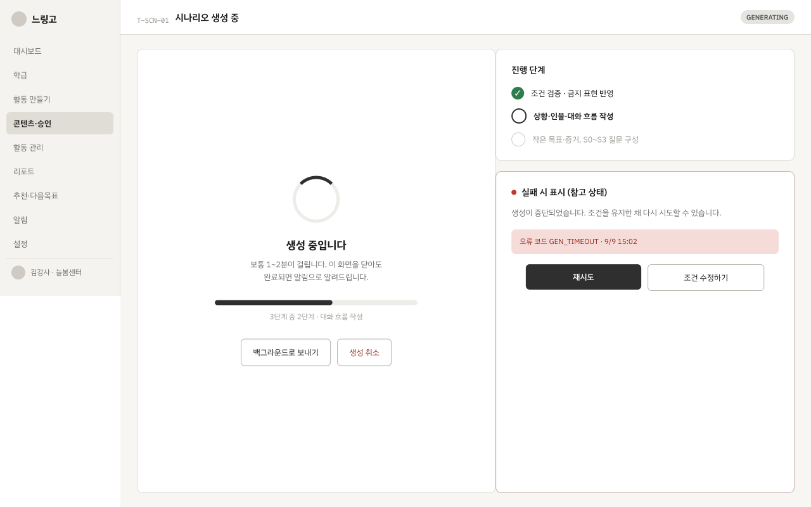
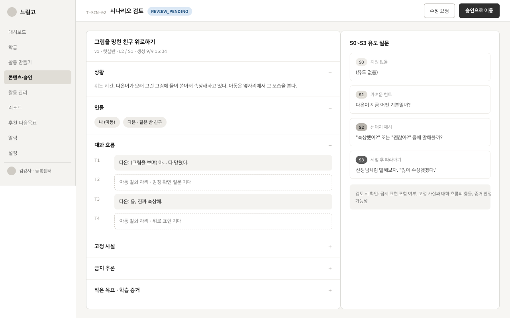
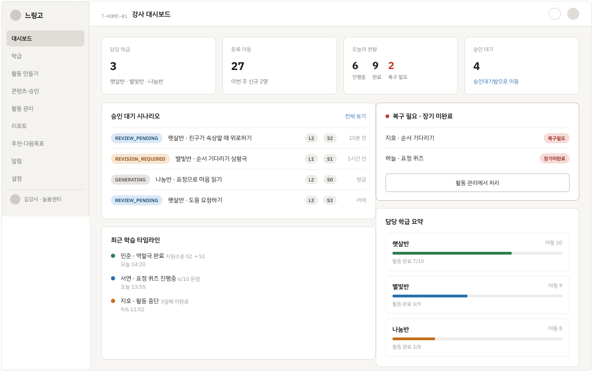
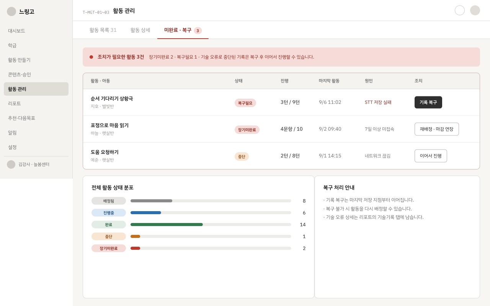
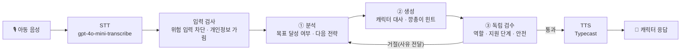
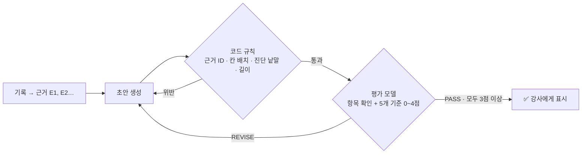
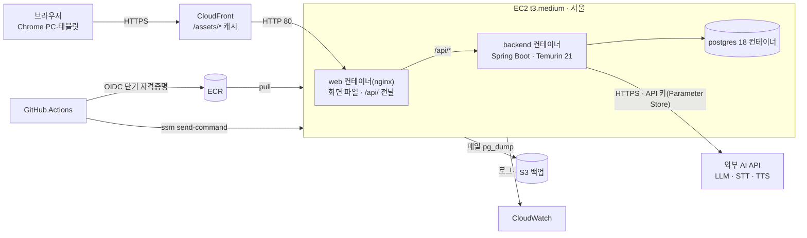
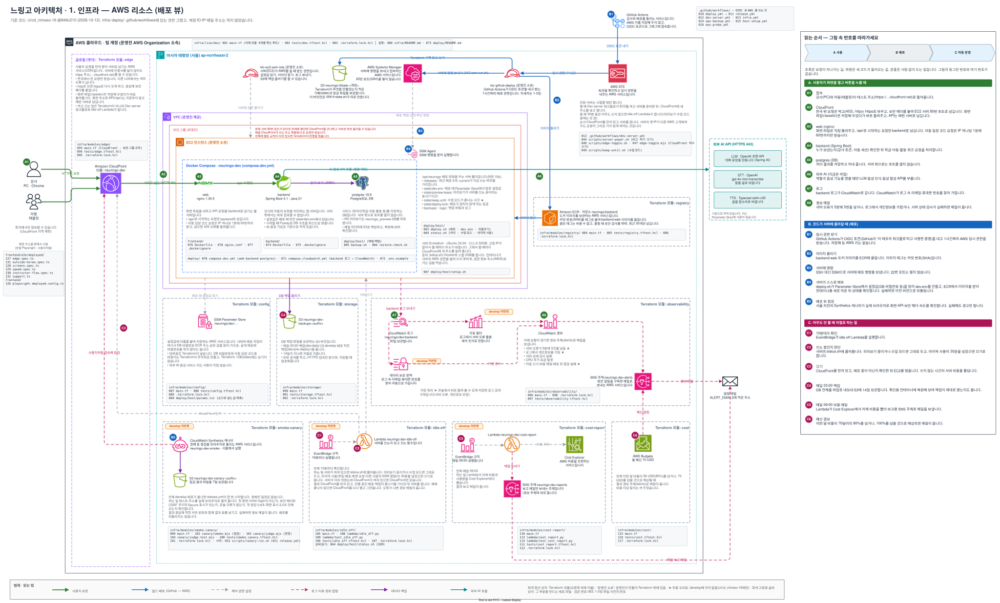

<h1 align="center">🐢 느링고 (Neuringo) 🐰</h1>

<div align="center">

<b>카카오테크 캠퍼스 4기 2단계 팀 프로젝트 · 전남대 4팀</b>
<br><br>
<b><i>천천히, 그래도 분명하게. 마음을 읽는 연습</i></b>
<br><br>
<b>느린 학습자를 위한 AI 감정 인식·공감 역할극 서비스</b>

<br><br>


</div>

---

<div align="center">

## 📖 목차

| 항목 |
|------|
| [🎨 소개](#-소개) |
| [🌟 주요 기능](#-주요-기능) |
| [🤖 AI 파이프라인](#-ai-파이프라인) |
| [💻 기술 스택](#-기술-스택) |
| [🛠 시스템 아키텍처](#-시스템-아키텍처) |
| [🚀 CI/CD](#-cicd) |
| [🧪 테스트와 품질 관리](#-테스트와-품질-관리) |
| [🗂 디렉터리 구조](#-디렉터리-구조) |
| [⚙️ 로컬 실행](#️-로컬-실행) |
| [📚 문서 모음](#-문서-모음) |
| [👥 팀원](#-팀원) |

</div>

---

## 🎨 소개

> *"친구가 왜 울고 있을까?" 그 질문에 스스로 답할 수 있을 때까지, 느링고가 옆에서 기다려 줍니다.*

**느링고**는 경계선 지능 등 **느린 학습자 아동**이 상대의 감정을 알아차리고 공감하는 말을 연습하도록 돕는 서비스입니다.

### 기획 의도

느린 학습자 아동은 사회적 상황에서 **무슨 일이 있었는지**, **상대가 어떤 마음인지**, **그 둘이 어떻게 이어지는지**를 알아차리는 데 시간이 더 걸립니다. 지금까지는 강사가 아동 한 명 한 명과 상황극을 하며 가르쳐야 했기 때문에 반복 연습 기회가 부족했고, 아동마다 수준에 맞는 상황을 준비하기도 어려웠습니다.

느링고는 이 과정을 **강사가 설계하고 AI가 함께 연습하는** 흐름으로 바꿉니다.

| 대상 | 느링고가 하는 일 |
|---|---|
| 👩‍🏫 **강사** | 학습 목표만 정하면 AI가 아동 수준(L1~L3)에 맞는 역할극 시나리오를 만듭니다. 강사가 **검토·승인한 시나리오만** 아동에게 배정되고, 활동이 끝나면 근거가 달린 학습 리포트와 다음 목표 추천을 받습니다. |
| 🧒 **아동** | 접근 코드로 쉽게 들어와 **표정 퀴즈**로 감정을 익히고, **음성 역할극**에서 캐릭터와 대화합니다. 막히면 토끼 **깡총이**가 단계별 힌트(S0~S3)를 줍니다. |

### 우리가 지킨 원칙

- **AI가 만든 것은 사람이 확인한 뒤에만 아동에게 갑니다.** 시나리오는 강사 승인을, 역할극 대사는 독립 검수를 통과해야 전달됩니다.
- **아동을 진단하지 않습니다.** 리포트에는 "장애", "산만" 같은 단정 표현을 쓰지 않으며, 모든 문장에 실제 기록 근거(E1, E2…)를 답니다.
- **기술 오류는 아동의 실패로 세지 않습니다.** 음성 인식·네트워크 오류는 학습 결과와 분리해 기록합니다.
- **개인정보는 AI에게 보내지 않습니다.** 전화번호·주소 등은 AI 호출과 로그 이전에 가리고, 표정 인식은 브라우저 안에서만 처리합니다.

---

## 🌟 주요 기능

### 👩‍🏫 강사 서비스

#### ✨ 학급·아동 관리
- 학급을 만들고 아동을 등록합니다. 로그인한 강사는 **자기 학급과 아동만** 볼 수 있습니다.
- 아동마다 **접근 코드**를 발급해, 아동이 계정 없이 들어올 수 있게 합니다.

#### ✨ 활동 만들기 (학습 목표 → 난이도 → 시나리오)
- 대상 아동과 활동 유형(표정 퀴즈 / 역할극)을 고르고, **학습 목표와 추가 조건**을 정합니다.
- 표정 퀴즈 결과로 **첫 역할극 난이도**를 정하고, 이후에는 이전 결과로 다음 난이도를 정합니다.
- 같은 학급·목표·조건·난이도의 **승인된 시나리오가 있으면 재사용**하고, 없으면 새로 생성합니다.

<div align="center">
<table>
  <tr>
    <td align="center"><br>시나리오 생성</td>
    <td align="center"><br>시나리오 검토·승인</td>
  </tr>
</table>
</div>

#### ✨ AI 시나리오 생성과 승인
- 학습 목표를 바탕으로 AI가 **상황·등장인물·사실·금지 추론·세부 목표(micro goal)**를 담은 시나리오를 만듭니다.
- 출력은 코드로 계약 검사(필수값·개수·길이·위험 낱말)를 거치고, 실패하면 실패 사유를 넘겨 다시 생성합니다.
- 강사는 시나리오를 검토해 **승인·수정 요청·반려**할 수 있으며, 버전 이력이 남습니다.

#### ✨ 활동 관리·대시보드
- 오늘의 현황, 승인 대기 시나리오, 미완료·복구가 필요한 활동을 한눈에 봅니다.

#### ✨ 학습 리포트·다음 목표 추천
- 역할극이 끝나면 **정량 지표**(퀴즈 정답률, 힌트 후 회복률, 목표 달성률, 독립 달성률)는 기록에서 바로 계산합니다.
- **AI 요약**은 생성 → 규칙 검사 → 평가 모델 검토를 최대 3번 되풀이해, 통과한 리포트만 강사에게 보여 줍니다.
- 결과에 따라 **다음 목표를 추천**하고, 다음 역할극 난이도(유지·하향·상향 후보)와 그 근거를 함께 보여 줍니다.

<div align="center">
<table>
  <tr>
    <td align="center"><br>강사 대시보드</td>
    <td align="center"><br>활동 관리</td>
  </tr>
</table>
</div>

### 🧒 아동 서비스

캐릭터의 역할을 고정해 아동이 헷갈리지 않게 했습니다. **🐢 거북이는 질문·안내**, **🐰 토끼 깡총이는 힌트·도움**을 맡습니다.

#### ✨ 접근 코드 입장
- 강사가 준 코드만 입력하면 바로 **내 활동 목록**으로 들어갑니다. 반복 입력은 횟수를 제한합니다.

#### ✨ 표정 퀴즈
- **내 감정 알기**: 상황을 듣고 그때의 표정을 카메라 앞에서 직접 지어 봅니다. 표정 인식은 [face-api](https://github.com/vladmandic/face-api)(TensorFlow.js)로 **브라우저 안에서만** 처리하고, 영상은 서버로 보내지 않습니다.
- **상대 감정 알기**: 상황이나 사진을 보고 상대의 감정을 고릅니다.
- 틀리면 힌트를 받고 다시 도전합니다. 퀴즈 결과는 첫 역할극 난이도를 정하는 데 쓰입니다.

<div align="center">
  
  <br>표정 퀴즈 흐름 (와이어프레임)
</div>

#### ✨ AI 음성 역할극
- 깡총이가 장면과 상대를 소개하면, 아동은 **목소리로** 캐릭터와 대화합니다. 마이크를 쓰기 어려우면 글자로도 답할 수 있습니다.
- 캐릭터는 아동의 말을 분석해 **사건 → 감정 → 연결** 순서의 학습 목표로 대화를 이끕니다.
- 같은 곳에서 막히면 **S0(열린 질문) → S1 → S2 → S3(답을 듣고 따라 하기)** 순서로 도움을 늘립니다.
- 녹음 실패·무음·네트워크 끊김·세션 만료 같은 상황마다 아동이 이해하기 쉬운 안내 화면을 둡니다.

---

## 🤖 AI 파이프라인

### 역할극 한 턴



| 단계 | 설명 |
|---|---|
| **입력 검사** | 위험한 입력은 AI 응답을 만들기 전에 막고, 전화번호·이메일·주소는 AI와 기록에 넘기기 전에 가립니다. 중복·순서가 어긋난 입력은 멱등 키로 거절합니다. |
| **분석** | 승인된 시나리오의 세부 목표별로 아동 발화에 근거가 있는지 판단합니다. 서버가 턴·목표·근거 참조를 고정하고, 모델은 관찰 결과만 돌려줍니다. |
| **생성** | 모델은 대사와 힌트만 출력하고, 후보 ID·목표·지원 단계 같은 값은 서버가 채웁니다. |
| **검수** | 생성 결과를 다른 프롬프트로 독립 검수합니다. 검수를 통과한 대사만 전달하며, 검사 장애 시에는 안전한 고정 응답을 쓰거나 전달하지 않습니다. |
| **시간 예산** | STT부터 TTS까지 한 턴 최대 60초를 공유합니다. |

> **지연 개선** — 캐릭터 분석·생성·검수의 입출력 계약을 줄여 요청 크기를 **분석 42.8% · 생성 48.3% · 검수 37.2%** 줄였고, 생성 출력은 330자 → 42자(87.3%)로 줄었습니다. 현재 계약으로 한 턴 **17.3초 · AI 호출 3회 · 첫 검수 통과**를 확인했습니다. ([결과 문서](backend/docs/roleplay-latency-improvement-results-2026-11-09.md))

### 학습 리포트 생성·평가 루프



- 코드 규칙을 평가 호출보다 먼저 돌려, 규칙에 걸리면 평가 모델을 부르지 않습니다(비용 절감).
- 최대 3바퀴 안에 통과하지 못한 리포트는 강사 화면에 보이지 않고, 정량 지표만 남습니다.
- 평가 기준: `grounded`(근거) · `non_diagnostic`(비진단) · `technical_separation`(기술 오류 분리) · `actionable`(활용 가능) · `readable`(쉬운 문장)

### 품질 측정

- 고정 입력 14턴 **품질 회귀 세트**로 모델·프롬프트를 바꿀 때마다 지연·토큰·비용·형식 실패율·PASS율을 비교합니다. (`./gradlew roleplayEval`)
- 시나리오 생성(`scenarioEval`), 리포트 루프 등 기능별 평가 세트와 진단 실행기가 있습니다.
- 프롬프트는 버전별로 관리합니다. → [`backend/src/main/resources/prompts`](backend/src/main/resources/prompts)

---

## 💻 기술 스택

| **분야** | **사용 기술** |
|---|---|
| **Frontend** |          |
| **Backend** |       |
| **AI** |    -FF6F00?style=for-the-badge&logo=tensorflow&logoColor=white) |
| **Database** |  |
| **Infrastructure** |         |
| **CI/CD · 보안** |    |
| **Monitoring** |   |
| **Test** |        |

---

## 🛠 시스템 아키텍처



<div align="center">
  
</div>

### 시스템 구성 요약

| 구성 요소 | 설명 |
|---|---|
| **프론트엔드** | React + Vite 빌드 결과를 서버의 **nginx 컨테이너**가 제공하고, `/api/` 요청은 백엔드로 넘깁니다. 화면과 API가 같은 커밋으로 함께 배포·롤백되고, 같은 출처라 CORS 없이 세션 CSRF를 그대로 씁니다. |
| **HTTPS** | 카메라·마이크는 HTTPS에서만 열리므로 **CloudFront 기본 주소**로 도메인·인증서 없이 HTTPS를 제공합니다. 정적 파일(`/assets/*`)만 캐시합니다. |
| **백엔드** | Spring Boot 컨테이너(비root 사용자)로 배포되며, PostgreSQL과 Flyway 마이그레이션으로 스키마를 관리합니다. |
| **비밀값** | AI API 키 등은 **SSM Parameter Store**에 두고 배포 시 서버 `.env`(권한 600)로만 전달합니다. 레포·GitHub·채팅에 두지 않습니다. |
| **인프라 코드** | 모든 AWS 리소스를 **Terraform**으로 관리합니다. 콘솔에서 손으로 만들지 않고, PR → plan 표 → 승인 → apply 경로로만 바꿉니다. 매일 drift를 검사합니다. |
| **비용 관리** | AWS Budgets 알림, plan 비용 가드, 그리고 **사용하지 않으면 서버를 자동으로 끄는 Lambda**(EventBridge 10분 주기)를 둡니다. |
| **백업** | 매일 `pg_dump` → S3에 저장하고, 임시 DB에 **실제로 복구해** 테이블·행 수까지 확인합니다. |

자세한 설계는 [CD·인프라 설계](docs/cd-architecture.md), [인프라(Terraform)](infra/README.md), [서버 배포](deploy/README.md)를 참고하세요.

---

## 🚀 CI/CD

<div align="center">
  
</div>

| 단계 | 내용 |
|---|---|
| **PR 검사** | Frontend CI(lint·타입·테스트) · Backend CI(마이그레이션 가드·Spotless·테스트) · E2E · Docker 빌드·기동 · CodeQL · 보안(gitleaks·공개 금지 파일) · 워크플로 lint |
| **PR 미리보기** | PR을 열면 **머지 전에** 그 PR 버전을 AWS 개발 서버에 띄워 직접 확인합니다. (`dev-server.yml`) |
| **배포** | `develop`에 머지되면 같은 커밋의 Frontend·Backend CI가 모두 통과했을 때만 화면과 백엔드를 **함께** 배포합니다. 상태 확인에 실패하면 자동으로 되돌립니다. |
| **인증** | GitHub OIDC로 1시간짜리 자격증명만 받습니다. SSH 22번 포트를 열지 않고 SSM으로 서버에 명령합니다. |
| **로컬 재현** | 모든 검사는 `bash scripts/verify.sh [frontend\|backend\|infra\|security\|e2e\|docker]`로 똑같이 돌려 볼 수 있습니다. |

전체 워크플로 목록은 [GitHub Actions 정리](docs/github-actions.md)에 있습니다.

---

## 🧪 테스트와 품질 관리

| 구분 | 내용 |
|---|---|
| **API 계약 테스트** | [`contracts/api-v1.json`](contracts) 하나를 백엔드(`ApiContractTest`)와 프론트(MSW 가짜 서버)가 함께 검사합니다. 한쪽만 바꾸면 다른 쪽 테스트가 깨집니다. |
| **API 명세** | 엔드포인트별 명세를 [`contracts/api/v1`](contracts/api/v1)에 정리했습니다. (인증·학급/아동·학습 목표·시나리오·활동·퀴즈·역할극·리포트/추천) |
| **백엔드** | JUnit 5 · Testcontainers(PostgreSQL) · MockServer로 **실제 AI API 없이** AI 실패 유형까지 테스트합니다. ArchUnit으로 도메인 간 순환 의존을 막습니다. |
| **프론트엔드** | Vitest + Testing Library + fast-check(속성 기반 테스트), 접근성(axe) · 보안 테스트 |
| **E2E** | 실제 백엔드·DB·프론트 빌드로 Playwright 브라우저 테스트 후, 응답·로그에 **개인정보 마커가 남지 않았는지** 스캔합니다. |
| **코드 스타일** | google-java-format(Spotless) · ESLint, pre-commit 훅으로 자동 정렬 |

테스트 작성법과 CI가 빨간색일 때 보는 표는 [testing.md](docs/testing.md)를 참고하세요.

---

## 🗂 디렉터리 구조

```text
ktc4-chonnam-4
├─ frontend/                 # React + Vite
│  ├─ src/features/
│  │  ├─ instructor/         # 강사: 대시보드·학급·아동·활동·시나리오 승인·리포트·추천
│  │  └─ child/              # 아동: 입장·활동 목록·표정 퀴즈·역할극 (camera/, roleplay/)
│  ├─ public/models/face-api # 브라우저 표정 인식 모델 가중치
│  └─ e2e/                   # Playwright
├─ backend/                  # Spring Boot (com.neuringo.neuringobe)
│  ├─ src/main/java/.../
│  │  ├─ auth · user         # 강사 가입·로그인, 아동 접근 코드 세션
│  │  ├─ classroom · child   # 학급·아동
│  │  ├─ goal                # 학습 목표·계보
│  │  ├─ scenario            # 시나리오 생성·승인·재사용, 난이도 정책
│  │  ├─ activity · assignment
│  │  ├─ quiz                # 표정 퀴즈
│  │  ├─ roleplay            # 역할극 세션·턴·입력 처리
│  │  ├─ learningrecord · report  # 학습 기록·리포트·추천
│  │  ├─ ai                  # LLM·STT·TTS 포트와 어댑터, 프롬프트, 구조화 출력 검사
│  │  └─ deletion · common · config
│  ├─ src/main/resources/prompts/  # 버전별 프롬프트
│  └─ docs/                  # 역할극·리포트 설계·실측 문서
├─ contracts/                # FE↔BE API 명세 (계약 테스트 기준)
├─ infra/                    # Terraform (live/dev, modules/*)
├─ deploy/                   # 서버 compose · 배포·백업 스크립트
├─ scripts/                  # verify.sh, 로컬 실행·검사 스크립트
└─ docs/                     # 아키텍처·CI/CD·테스트·AI 품질·PoC·와이어프레임
```

---

## ⚙️ 로컬 실행

**백엔드** (JDK 21, Docker 필요)

```bash
cd backend
cp .env.example .env   # DB_USERNAME, DB_PASSWORD 채우기
./gradlew bootRun      # PostgreSQL 컨테이너가 자동으로 뜹니다
```

**프론트엔드** (Node.js)

```bash
cd frontend
npm ci
npm run dev
```

**전체 검사**

```bash
bash scripts/verify.sh
```

AI 기능은 기본으로 꺼져 있으며, 실제 모델을 쓰려면 `backend/.env.local`에 `AI_MODEL`·`AI_BASE_URL`·`AI_API_KEY`를 넣습니다. 자세한 내용은 [백엔드 README](backend/README.md)와 [로컬 스크립트](scripts/local/README.md)를 참고하세요.

---

## 📚 문서 모음

| 주제 | 문서 | 주제 | 문서 |
|---|---|---|---|
| 시나리오 생성 프롬프트 | [scenario-generation.md](docs/scenario-generation.md) | 학습 리포트·추천·후속 난이도 | [learning-report-loop.md](backend/docs/learning-report-loop.md) |
| AI 품질 회귀 측정 | [ai-quality-measurement.md](docs/ai-quality-measurement.md) | 역할극 지연 개선 결과 | [roleplay-latency-improvement-results](backend/docs/roleplay-latency-improvement-results-2026-11-09.md) |
| AI 제공자 공통 계약 | [ai-provider-contract.md](backend/docs/ai-provider-contract.md) | 역할극 HTTP API | [roleplay-http-api.md](backend/docs/roleplay-http-api.md) |
| CD·인프라 설계 | [cd-architecture.md](docs/cd-architecture.md) | GitHub Actions | [github-actions.md](docs/github-actions.md) |
| 테스트 가이드 | [testing.md](docs/testing.md) | API 연동 가이드 | [integration-guide.md](contracts/api/v1/integration-guide.md) |
| PoC 회고 | [poc-review](docs/poc/2026-09-09-poc-review.md) | 와이어프레임 | [week-1](docs/wireframes/week-1/README.md) |

---

<div align="center">

## 👥 팀원

<table>
  <tr>
    <th>Picture</th>
    <td align="center"><a href="https://github.com/bji0319"></a></td>
    <td align="center"><a href="https://github.com/pado0711"></a></td>
    <td align="center"><a href="https://github.com/LearnToThink777"></a></td>
    <td align="center"><a href="https://github.com/lgwoo"></a></td>
    <td align="center"><a href="https://github.com/SangHyeonY"></a></td>
  </tr>
  <tr>
    <th>Name</th>
    <td align="center">배재일</td>
    <td align="center">진미나</td>
    <td align="center">정민서</td>
    <td align="center">lgwoo</td>
    <td align="center">SangHyeonY</td>
  </tr>
  <tr>
    <th>Position</th>
    <td align="center">Backend · Frontend<br>강사 서비스<br>시나리오 승인 · 활동</td>
    <td align="center">Backend · AI<br>역할극 파이프라인<br>입력 처리 · 안전</td>
    <td align="center">DevOps · QA<br>CI/CD · 인프라<br>리포트 연동</td>
    <td align="center">AI · Backend<br>시나리오 생성<br>AI 품질 측정 · 음성</td>
    <td align="center">Frontend<br>아동 서비스<br>퀴즈 · 역할극 화면</td>
  </tr>
  <tr>
    <th>GitHub</th>
    <td align="center"><a href="https://github.com/bji0319"></a></td>
    <td align="center"><a href="https://github.com/pado0711"></a></td>
    <td align="center"><a href="https://github.com/LearnToThink777"></a></td>
    <td align="center"><a href="https://github.com/lgwoo"></a></td>
    <td align="center"><a href="https://github.com/SangHyeonY"></a></td>
  </tr>
</table>

</div>
